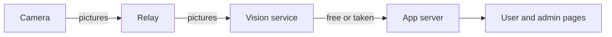

# Find my Bike Slot

See which bike racks still have free spaces before you arrive, counted live by a small camera that blurs people and
licence plates before a picture ever leaves it.

Built in one weekend at BaselHack 2026 (Basel, 30 October to 1 November 2026) by team NextGen for the
Endress+Hauser challenge "Find my Bike Slot". This repository is a copy of the final state we presented; the team
repository with the full history is
[manuel-buser/NextGen_BaselHack2026](https://github.com/manuel-buser/NextGen_BaselHack2026). Camera test photos
that show people were left out of this copy.

## The challenge

How might we help employees quickly find a free bicycle parking space at the company site? Racks fill up, and
nobody knows where the free spaces are before arriving. The no-gos: storing faces, licence plates or other personal
data, and identifying or tracking people.

## What it does

- A map of the parking places with their free spaces, refreshed every few seconds.
- Each place opens to show every space, free or taken, and a chart of a typical day ("usually full by 8:40").
- "Where are you going?" finds the nearest place with free spaces to your destination, with walking minutes.
  "Nearest to me" uses the phone's location, which never leaves the phone.
- An estimate of how many spaces will be free when you arrive, from the usual pattern and how today differs.
- An admin page with the camera's status, an animated diagram of the data flow and the live activity.
- One command puts the demo on a public link with a QR code; visitors can watch but not send data.

## How it works



1. **Camera** ([camera/](camera/)): a Seeed XIAO ESP32-S3 Sense takes a still picture every few seconds. An
   on-chip person detector blurs heads and shoulders and a colour finder blurs yellow and white licence plates
   before the picture leaves the board.
2. **Relay** ([relay/](relay/)): where the venue Wi-Fi does not reach, the camera sends its pictures over a phone
   hotspot to a small cloud service that keeps only the newest picture per camera, in memory. On the same network
   the vision service can also fetch the pictures from the camera directly.
3. **Vision service** ([code/bikeslot/](code/bikeslot/)): decides for every space whether it is free or taken.
   The space outlines are drawn once per camera on a reference picture, and every new picture is first aligned to
   it by feature matching, so a bumped or turned camera still fits its outlines. The aligned picture is cut into
   one crop per space, a small image classifier (MobileNetV3-small) answers free or occupied, a bike detector
   frees hooks that only caught the edge of a neighbouring bike, and the answers are smoothed over the last few
   pictures. A second engine detects bikes with YOLO11 segmentation, matches them to the spaces and can propose
   the space layout for a new camera.
4. **App** ([code/app/](code/app/)): a FastAPI server reads only the decided spaces, keeps a per-minute history of
   the free counts, forecasts the day and serves the user and admin pages.

In the demo the camera watched one bay of a real row of hanging bike spaces next to the venue; the other bays and
two more racks ran on simulated counts to show a whole site.

## Privacy by design

- People and licence plates are blurred on the camera, before anything is sent.
- The relay keeps only the newest picture per camera, in memory.
- The vision service blurs people again and keeps only its latest annotated preview, replaced with every picture.
  For the alignment it stores feature points of the reference picture, never its pixels.
- The app receives free or taken per space, never a picture, and its history stores counts only.
- The public link is read-only.

## Try it

You need Git, Python 3.8 or newer and an internet connection. Then:

```bash
git clone https://github.com/jevinthaiparampil/find-my-bike-slot.git
cd find-my-bike-slot/code/app
python3 tools/deploy.py        # Windows: py tools\deploy.py
```

The script lists what is still missing (uv, Python 3.12, the app's packages, cloudflared) and installs it after one
question, into `code/app/.deploy` and `code/app/.venv`; deleting both folders removes everything. It then starts the
app with simulated racks, opens a temporary Cloudflare link in a new browser window and prints it as a QR code;
Ctrl+C stops everything. Without the camera and the vision service all counts are simulated, including the bay
marked as the camera's. More ways to run the app: [code/app/README.md](code/app/README.md). The vision service:
[documentation/vision-pipeline.md](documentation/vision-pipeline.md). The camera:
[camera/INSTALLGUIDE.md](camera/INSTALLGUIDE.md).

## Repository layout

| Folder | What |
|---|---|
| [camera/](camera/) | Camera firmware (ESP-IDF) and install guide |
| [relay/](relay/) | Cloud relay for the camera pictures |
| [code/bikeslot/](code/bikeslot/), [code/scripts/](code/scripts/), [code/tests/](code/tests/) | Vision service, calibration and training scripts, tests |
| [code/app/](code/app/) | App: server, user page, admin page, demo tools, tests |
| [documentation/](documentation/) | Interfaces between the parts, vision pipeline, slot classifier, demo runbook |
| [assets/](assets/) | Demo and AI-generated pictures, labelled data, the classifier's weights |

## Team NextGen

| Part | Team members |
|---|---|
| Camera: firmware, on-camera blurring, relay | Jiri Käser, Denis Mustafa Xhabrahimi |
| Vision service and classifier | Manuel Buser, Jiri Käser, Jevin Jiji Thaiparampil |
| App: backend, user and admin pages, UI and UX, public demo | Jevin Jiji Thaiparampil |
| Demo and pitch | The whole team |

## License

MIT, see [license.txt](license.txt).
